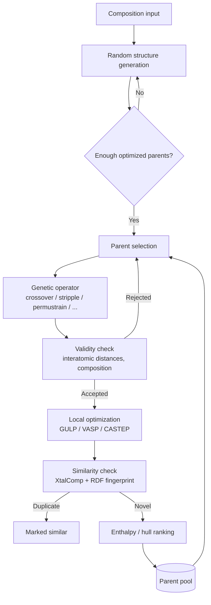

# XtalOpt Architecture

XtalOpt is the evolutionary crystal structure prediction code this project
builds on. This page covers what a crystal structure is, why prediction is hard,
how XtalOpt represents and evolves structures, and where it differs from USPEX.

## Crystal structure 101

A crystal is a periodic arrangement of atoms. The **unit cell** is the smallest
repeating block; tiling it infinitely in three dimensions reconstructs the whole
crystal. So describing a crystal means describing one cell.

That takes two things:

**The container** — six lattice parameters. Three edge lengths $a$, $b$, $c$ and
three angles $\alpha$, $\beta$, $\gamma$ define the parallelepiped that repeats.

**The contents** — where the atoms sit inside it. Positions are given as
*fractional coordinates*, each in $[0, 1)$, expressed as a proportion along each
cell edge rather than in absolute distance. This keeps the description
independent of cell size.

<figure class="unit-cell-figure">
<svg viewBox="0 0 520 320" role="img"
     aria-label="A unit cell drawn as a parallelepiped, with edge vectors a, b and c meeting at one corner and the angles alpha, beta and gamma between them">
  <g fill="none" stroke="currentColor" stroke-width="1.6"
     stroke-linecap="round" stroke-linejoin="round">
    <!-- hidden edges, meeting at the rear vertex -->
    <g stroke-dasharray="5 5" opacity="0.45">
      <path d="M110 240 L260 180" />
      <path d="M260 180 L430 210" />
      <path d="M260 180 L260 40" />
    </g>
    <!-- visible edges -->
    <path d="M110 240 L280 270 L430 210" />
    <path d="M110 240 L110 100 L260 40 L430 70 L430 210" />
    <path d="M110 100 L280 130 L430 70" />
    <path d="M280 270 L280 130" />
  </g>
  <!-- edge vectors from the origin corner -->
  <g fill="none" stroke="currentColor" stroke-width="2.6" stroke-linecap="round">
    <path d="M110 240 L280 270" />
    <path d="M110 240 L260 180" />
    <path d="M110 240 L110 100" />
  </g>
  <!-- angle arcs at the origin corner -->
  <g fill="none" stroke="currentColor" stroke-width="1.3" opacity="0.75">
    <path d="M158 248 A 50 50 0 0 0 150 220" />
    <path d="M150 220 A 58 58 0 0 0 110 182" />
    <path d="M110 198 A 42 42 0 0 0 148 244" opacity="0" />
  </g>
  <!-- atoms at fractional positions inside the cell -->
  <g fill="currentColor" opacity="0.8">
    <circle cx="250" cy="175" r="8" />
    <circle cx="205" cy="120" r="6" />
    <circle cx="320" cy="195" r="6" />
  </g>
  <g fill="currentColor" font-size="19" font-style="italic"
     font-family="Georgia, 'Times New Roman', serif">
    <text x="196" y="277">a</text>
    <text x="186" y="196">b</text>
    <text x="88" y="174">c</text>
  </g>
  <g fill="currentColor" font-size="15" opacity="0.8"
     font-family="Georgia, 'Times New Roman', serif">
    <text x="163" y="236">&#947;</text>
    <text x="131" y="206">&#945;</text>
    <text x="137" y="252">&#946;</text>
  </g>
</svg>
<figcaption>

*The unit cell. Three edge vectors $a$, $b$, $c$ and the three angles between
them — $\gamma$ between $a$ and $b$, $\beta$ between $a$ and $c$, $\alpha$
between $b$ and $c$ — define the container. The atoms inside it, placed at
fractional coordinates, are the contents. Dashed edges run behind the cell.*

</figcaption>
</figure>

## Why structure prediction is the problem

A material is defined by both what atoms are present and how they are arranged.
Arrangement alone can change everything: carbon in one arrangement is graphite,
soft enough to write with; in another it is diamond.

Crystal structure prediction (CSP) asks the resulting question — **given a set
of atoms, how do they arrange themselves into a stable structure?** Only a small
number of stable arrangements are known. A new, physically realisable stable
structure is, in effect, a new material.

The search is hard because of scale. There are thousands of plausible
compositions, and for each one a continuous space of possible atomic
arrangements. Exhaustive enumeration is out of the question, and the
experimental alternative is worse: a single material takes months to synthesise
and test, and most attempts turn out to be unstable.

This makes it an optimisation problem over a space that is high-dimensional,
non-convex, discontinuous, and heavily constrained — the conditions under which
evolutionary algorithms do well.

## Representation

XtalOpt evolves structures directly in their natural crystallographic form. A
structure's genome is the six lattice parameters plus the fractional coordinates
of its atoms:

$$6 + 3(N-1)$$

for $N$ atoms — six for the cell, three per atom, less three because fixing the
origin removes a redundant translational degree of freedom. This is enough to
reconstruct the full three-dimensional crystal.

Representing crystals this way is a deliberate choice. The variation operators
can then be **domain-aware**: they manipulate lattices and atomic positions as
physical objects, so an operator can be written to respect the geometry rather
than scrambling an abstract bit string.

## Genetic operators

XtalOpt generates offspring with five operators. Which ones are available
depends on the search type — the last two change composition, so they only apply
to variable-composition runs.

| Operator | What it does |
|---|---|
| **Crossover** | Cuts two parent cells into slabs and splices them, combining spatial fragments of both |
| **Stripple** | Applies a periodic (ripple) displacement to atomic coordinates together with a lattice strain |
| **Permustrain** | Swaps atoms of different species and strains the cell |
| **Permutomic** | Swaps atomic species — changes which element sits where |
| **Permucomp** | Permutes the composition itself, changing the stoichiometry |

Each is applied with a configurable relative weight. Random structure injection
is also used during the initial phase to seed the population and to maintain
exploration.

::: info Figure pending
`operators.png` — a small panel showing crossover (two cells cut and spliced)
and stripple (a cell before and after the ripple displacement). Only worth
including if it can be drawn clearly at small size.
:::

## The search loop

The pipeline below is one pass of the evolutionary loop. It runs continuously:
the queue manager keeps a target number of structures in flight, and every time
a slot opens a new candidate is generated.

The stages, in order:

**Generation.** Until enough optimised parents exist, structures are created at
random — optionally with imposed symmetry, so that generated candidates are
chemically sensible rather than arbitrary point clouds. After that, offspring
come from the operators above.

**Validity checking.** Before a candidate is accepted it is checked for physical
plausibility, principally that no two atoms sit closer than their combined
covalent radii allow.

**Local optimisation.** XtalOpt does not compute energies itself. It writes
input files for an external code — GULP, VASP, CASTEP, PWSCF, SIESTA — and
submits the job through a queue interface, local or remote. The external code
relaxes the structure to a nearby local minimum and returns the energy.

**Similarity filtering.** Relaxation tends to funnel different starting
structures into the same minimum. Duplicates are detected and removed so the
population does not collapse onto one answer.

**Ranking.** Surviving structures are ranked by enthalpy, or by distance above
the convex hull for variable-composition searches, and the best become the
parent pool for the next round.

## XtalOpt and USPEX

Both are evolutionary CSP codes and both work the same way in outline. USPEX is
the older and more established of the two, with a longer record of experimental
confirmations — predicted uranium hydride phases later verified in the lab, and
the mineral zaccariniite recovered in sixteen generations without prior
structural data.

The relevant difference for us is access.

| | USPEX | XtalOpt |
|---|---|---|
| Licence | Proprietary, closed source | Open source |
| Implementation | — | C++ / Qt |
| Operators | Fixed | Modifiable |
| Extension | Not possible | Scripts and custom modules |
| Maturity | More advanced modules | Fewer; built for experimentation |

USPEX cannot be modified, so the evolutionary operators cannot be changed,
cathode-specific structural constraints cannot be injected, and a
quality-diversity archive cannot be added. XtalOpt can be extended on all three
counts, which is why it is the base system here even though USPEX is the more
mature code. XtalOpt has its own record — it predicted a previously unknown
structure for Mg₃BN₃.

What XtalOpt does *not* provide, and what this project adds, is covered in the
Implementation section: a behaviour-space archive in place of Pareto selection
(see [MOME / MAP-Elites](/background/moqd)), and composition input that can
express dopant substitution across chemical systems.

## References

- Glass, C. W., Oganov, A. R., & Hansen, N. — *USPEX — Evolutionary crystal
  structure prediction*, Computer Physics Communications, **175**, 713–720,
  2006. [DOI](https://doi.org/10.1016/j.cpc.2006.07.020)
- Lyakhov, A. O., Oganov, A. R., Stokes, H. T., & Zhu, Q. — *New developments in
  evolutionary structure prediction algorithm USPEX*, Computer Physics
  Communications, **184**, 1172–1182, 2013.
  [DOI](https://doi.org/10.1016/j.cpc.2012.12.009)
- Falls, Z., Lonie, D. C., Avery, P., Shamp, A., & Zurek, E. — *The XtalOpt
  evolutionary algorithm for crystal structure prediction*, The Journal of
  Physical Chemistry C, **125**, 1601–1620, 2021.
  [DOI](https://doi.org/10.1021/acs.jpcc.0c09531)
